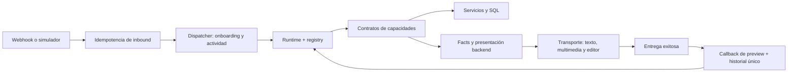

# Arquitectura

El backend usa un único agente de herramientas para texto y respuestas interactivas.
El modelo propone capacidades y datos; el backend conserva identidad, cálculo,
referencias, revisión, autorización y presentación financiera.

## Stack y entrada

Python 3.11, FastAPI async, SQLAlchemy, Redis, APScheduler y Meta WhatsApp Business
API. Providers Gemini, Mistral y DeepSeek en `llm_providers`, seleccionados por
`LLM_PROVIDER`; prompt breve `prompts/core_prompt.md`, con `prompt.md` de respaldo.
Streamlit en `testing/` comparte la misma entrada y simula sólo el transporte.

`main.py` conserva webhook, health, cotizaciones para dashboard, administración de
flujos y lifespan/scheduler. `dispatcher.py` expone `process_incoming_message` y
`process_incoming_interactive_reply`, y devuelve `DispatchResult` de
`dispatch_contract.py`. Aplica onboarding y registra actividad24h antes de entrar
al agente; no enumera intenciones ni capacidades financieras.



El webhook responde200 y procesa con BackgroundTasks en el mismo proceso: no es
una cola durable. Los wrappers textual/interactivo de `webhook_idempotency.py`
reclaman por inbound ID, silencian duplicados y completan el claim después de
procesar/envíar. Typing y reacciones son señales de mejor esfuerzo.

## Componentes del agente

- `assistant_catalog.py` compone 42 herramientas de `assistant_capabilities/`.
  `ToolContract/ToolPolicy` declaran schema, permisos, efecto, timeout,
  interrupción y fin de turno; `OperationContract` declara borrador/preparado y
  handler. La política guía el loop, sin listas de nombres de dominio.
- `assistant_runtime.py` fija contexto backend, ejecuta llamadas nativas y valida
  el lote completo antes de producir efectos. Presupuesto:4 rondas,6 lecturas y
  una nueva propuesta por pedido; prepare/control se ejecutan solos. No hay tool
  de commit disponible para el modelo.
- `assistant_operations.py` valida el workspace y las transiciones; `assistant_state.py`
  toma claim por dueño y guarda el estado efímero. `assistant_context.py` emite
  handles ligados a cuenta, conversación, tipo, esquema y expiración. El proveedor
  recibe datos visibles/refs, nunca UUIDs canónicos ni secretos de enlaces.
- `assistant_actions.py` resuelve confirmación y callbacks del editor bajo claim;
  `assistant_transport.py` ensambla facts, multimedia, botones y eventos.
  `assistant_capabilities/movement_effects.py` es dueño del feedback de presupuesto
  y propuesta recurrente posteriores al commit.
- `llm.py` conserva configuración/prompt y renderer financiero protegido;
  `llm_providers` serializa tools, calls/outcomes y continuaciones nativas. No
  existen `process_message`, `intent_routing`, `llm_contract`, `reference_resolution`
  ni stubs que pretendan interpretar audio/recibos.
- `conversation.py` conserva cliente Redis, navegación publicada y
  `ConversationHistoryService`. No mantiene pendings financieros paralelos.

Los servicios de movimientos, categorías, billeteras, límites, presupuesto,
compensación, recordatorios, recurrencias, gráficos, balance, patrimonio,
cotizaciones, educación, inversiones y dashboard siguen siendo dueños del dominio.
La [matriz de etapa4](assistant-stage4-coverage.md) documenta las 42 capacidades;
el [cierre de etapa5](assistant-stage5-coverage.md) documenta entrada global y puertos.

### Cómo agregar una capacidad sin romper la arquitectura

`dispatcher.py` es una puerta de entrada mínima: onboarding/actividad, `run_for_phone` y
`assemble_reply`; las respuestas interactivas usan `process_interaction`. No debe contener regex,
clasificadores ni ramas de intención, y `app/main.py` tampoco debe agregarlos. Un pedido en
lenguaje natural siempre entra por el runtime de herramientas.

Para una lectura, consulta o enlace (por ejemplo, conectar Google Calendar):

1. Definir un `ToolContract`/`read_tool` con `FrozenModel`/`StrictInput` en el módulo de dominio
   de `assistant_capabilities/`.
2. Registrar el contrato en `assistant_catalog.py`.
3. Si emite un CTA, agregar el `WhatsAppCTAURL` a `context.outbound`, fijar `event_key` y
   `event_variables`, y devolver `data(context, [], [body])`. El transporte debe tratar el evento
   como mensaje primario único para no duplicar el texto.

Para una mutación:

1. Crear un `OperationContract` con `prepare` y `commit` en el módulo de dominio.
2. Exigir preview entregada y confirmación ligada a operación, revisión y hash.
3. Registrarlo en `assistant_catalog.py`; no modificar el loop de `assistant_runtime.py`.

La presentación es determinista: los valores salen de `VerifiedFact`/`Presenter` o de
`render_financial_reply` con placeholders `{{KEY}}`; nunca de texto libre del modelo.

## Estado, tiempo y selección

Workspace v2 usa namespace Redis `assistant:v3` al corte: una activa, hasta tres
abiertas y hasta tres terminales, treinta minutos sin extender expiración de una
operación al consultarla/retomarla. Estado v2 incompatible se ignora; no se inventa
un efecto económico para migrarlo. Receipts SQL permanecen intactos.

Al alcanzar el límite de abiertas no se descarta ningún borrador: la apertura se
rechaza y el mensaje enumera las propuestas abiertas para confirmar o cancelar una.
Ninguna operación pierde datos por presión de capacidad.

Una lectura o una nueva propuesta suspende el borrador previo. Suspender, enmendar,
retomar, cancelar o vencer cambia revisión e invalida confirmación. Recopilar
filtros para una lectura, como un gráfico, no exige aprobar una escritura inexistente.
Retomar collecting permite aplicar datos del mismo mensaje; si faltan, pregunta backend.

Cada campo conserva texto/ID/día del turno que lo aportó. DateSpec valida evidencia
literal completa; una fecha resuelta no cambia al retomar y una relativa nueva
usa el día del mensaje de modificación. Períodos civiles son inclusivos;
MonthSelector recibe YYYY-MM y backend calcula último día. Scopes sólo se restringen.

Los registros mutados publican nuevos snapshots/ref visibles; los anteriores no
se actualizan y siguen rechazando propuestas stale. Una selección numérica se
consume en la preparación del turno en que se elige: no queda adherida para
rechazar un cambio explícito posterior y las opciones viejas no se reimprimen.
Categoría y billetera son campos separados y una hija no pierde campos ya elegidos
de su padre.

Solo una referencia vencida o un snapshot cambiado se informan como datos
desactualizados; un dato inválido del borrador, como una fecha imposible, conserva
su propio mensaje y no se presenta como si el registro hubiera cambiado.

## Escrituras, política y recibos

El backend exige `economic_effect` explícito: cash_flow para ingreso/gasto real;
principal, colocación e inversión existente no se registran como flujo. Un efecto
indeterminado recopila aclaración humana sin un default permisivo. La frontera es
estructurada, no un clasificador textual de inversiones reubicado en otro archivo.

Toda mutación muestra su propuesta antes de confirmar. Ready no autoriza: el
callback acredita la propuesta completa después del envío exitoso, tomando claim
y comprobando operación/revisión/hash. Botón o sí posterior deben corresponder a
esa revisión y otro inbound ID. Una consulta invalida el sí/botón anterior.
Una propuesta larga puede enviarse en texto y los botones en followup; no se
afirma entrega de botones fallidos ni se confunde otro followup con una propuesta.

`movement_commands.py` bloquea al propietario en PostgreSQL y guarda mutación y
receipt en la misma transacción. Registro, lote de2–5, corrección, update y
anulación conservan snapshots/IDs; fallo de item/receipt revierte todo el lote.
Replay usa el resultado guardado sin feedback duplicado; save de contexto fallido
después de commit no anuncia rollback financiero. Otros dominios conservan las
garantías concretas de su servicio; no se promete atomicidad genérica entre ellos.

Compensación sugerida tras exceder límite es otro borrador revisable, nunca
autocommit. Crear categoría hija prevalida el padre y vuelve con una propuesta del
padre que requiere otra confirmación. Las selecciones son refs propias, no IDs
aportados por el modelo.

## Presentación, editor e historial

Facts obligatorios se incluyen aunque el modelo no copie todos sus IDs. Patrimonio
y cotizaciones conservan renderer con placeholders, validación, un reintento y
fallback determinístico de los mismos facts; datos/cifras salen del backend.
Los módulos de gráficos producen PNG y captions, usando ChartRequest.periods,
query_chart, prepare_charts y MovementChartService.render_png.

El editor publicado conserva versión/nodo/opción y binding interno separado de
variables editables: operación/revisión/hash o nonce de interacción, preservado
al navegar. Tokens de dos entregas del mismo nodo son distintos; botón/callback
tardío de A no ejecuta ni habilita B. Presentación configurada acompaña los facts.

Sólo ConversationHistoryService guarda conversación visible: últimos4 turnos
completos, saneados, TTL24h, append/trim/deduplicación atómicos después del envío.
Reset limpia historial tras entregar su respuesta y conserva registros/receipts.
El workspace no es un segundo historial. Telemetría conserva fases LLM/DB/Redis/
eventos/reply y trazas de tools, sin volcar credenciales a logs.

WebhookModeService usa IDs simulados únicos y ambos wrappers reales, con éxito de
transporte sintético explícito. Botones/listas vuelven por el mismo dispatcher;
sidebar cambia realmente modelo/prompt. No demuestra entrega Meta ni Redis real.

## Borde HTTP y verificación de despliegue

`POST /webhook` valida `X-Hub-Signature-256` (HMAC-SHA256 del cuerpo crudo) cuando
`WHATSAPP_APP_SECRET` está configurado; si falta, el entorno local acepta payloads sin
firma para no romper el simulador y Render registra una advertencia al arrancar. El
envío sale por `WHATSAPP_GRAPH_BASE_URL` (default `https://graph.facebook.com`), de modo
que tests y staging pueden apuntarlo a un mock que capture los mensajes sin tocar Meta.

`GET /version` informa servicio, commit (`RENDER_GIT_COMMIT`) y cantidad de migraciones
locales. `GET /health` responde 200 e informa base, Redis y estado de migraciones;
`GET /ready` responde 503 si la base o Redis fallan o si hay migraciones pendientes.
El estado compara los archivos de `supabase/migrations/` con
`supabase_migrations.schema_migrations`; en SQLite local informa `unknown` en lugar de
fallar. Un liveness check de Render no debe usar `/ready` durante un deploy con
migraciones en curso.

En staging se puede activar `WHATSAPP_TRANSPORT=capture` (con `APP_ENV=staging` y
`TEST_INGRESS_TOKEN`): el cliente no llama a Graph, guarda el payload en Redis y lo publica
en `GET /__test__/outbox` para que el runner de `staging_tests/` verifique botones y textos
sin depender de Meta. Fuera de staging esos endpoints responden 404.

Como alternativa sin segundo entorno, `TEST_CAPTURE_PHONES` permite capturar solo los
teléfonos listados aun en producción: el resto de los envíos sigue saliendo por Meta. Exige
`TEST_INGRESS_TOKEN`; sin él la captura y el outbox quedan deshabilitados.

## Scheduler

`app/scheduler.py` usa un `AsyncIOScheduler` que arranca en el `lifespan` de la app.
Corre dos jobs cada 5 minutos y está pensado para un único worker (el `Dockerfile`
usa `gunicorn -w 1`).

- `check_reminders`: envía el aviso de cada recordatorio activo el día anterior al
  vencimiento, una vez por mes (`ultimo_aviso_enviado`). Si la ventana de 24 horas de
  WhatsApp está abierta manda texto libre; si está cerrada usa el template configurado
  en `WHATSAPP_REMINDER_TEMPLATE_NAME` y omite el envío si no hay template.
- `check_proactive_prompts`: solo dentro de la hora local
  `PROACTIVE_PROMPT_HOUR` (America/Argentina/Buenos_Aires) y para usuarios con
  `proactivo_habilitado`, `whatsapp_id`, ventana de 24h abierta y sin movimientos
  vigentes de hoy. `proactivo_ultimo_envio` se reclama antes de enviar para garantizar
  como máximo un aviso diario y se libera si el envío falla.
- Un pedido de acceso al dashboard también refresca `ultimo_mensaje_en` y reabre esa ventana.

## Cotizaciones y capital consolidado

`query_net_worth` («¿cuánto tengo?») consolida los saldos actuales de todas las
billeteras del usuario, sin filtro de fechas: un total en ARS y un total en USD
expresados en sus monedas originales. El LLM puede devolver `quote_types`; si no lo
hace, el backend cotiza los tres tipos (`oficial`, `mep`, `blue`) y si los especifica
solo usa los pedidos.

Flujo de cotizaciones:

```text
Usuario / dashboard BFF
  -> GET /api/cotizaciones?tipos=oficial,mep,blue (o dispatcher -> get_usd_quotes)
  -> app/services/currency.py
  -> Redis (luka:quote:usd:{tipo})
  -> si no hay dato fresh: DolarAPI /v1/dolares
```

- Cada cotización se cachea por tipo en Redis con TTL `CURRENCY_STALE_SECONDS`
  (86400 s por defecto). Se considera *fresh* durante `CURRENCY_CACHE_TTL_SECONDS`
  (900 s por defecto); fuera de esa ventana se intenta refrescar. Solo si ese refresco
  falla y el dato sigue dentro del TTL se devuelve marcado `stale=true` (hasta 24 h).
- El lock de fetch es por proceso y por tipo: evita estampidas dentro de un worker,
  no entre workers. Escalar a más workers requiere un lock distribuido.
- Los eventos `hit`, `miss` y `stale` se emiten con el mensaje `currency_cache` y
  adjuntan `tipo`, `event` y `latency_ms` como atributos del `LogRecord` vía `extra`
  y, además, dentro del propio mensaje (`currency_cache tipo=... event=... latency_ms=...`),
  que es lo que imprime el formatter actual. No se persisten cotizaciones en PostgreSQL:
  el caché es efímero.
- DolarAPI puede devolver `compra` ausente o inválida; en ese caso la cotización
  conserva `venta` y `compra=null`, y el capital no se calcula con ese tipo.
- `/api/cotizaciones` acepta `tipos` separados por coma, responde `400
  tipo_invalido` ante un tipo desconocido y `503 cotizaciones_no_disponibles` si no
  hay ningún dato; el dashboard muestra el saldo original en ese caso.

La valuación del capital es a **compra**: `total_ars + total_usd * compra`, calculada en
`app/services/net_worth.py`. El backend nunca inventa una tasa. Cada tipo pedido aporta un
fact `{TIPO}_TOTAL` (`total no disponible` si falta la cotización o su compra) y un fact
`{TIPO}_STALE` cuando el refresco falló pero el dato sigue vigente en caché. El módulo financiero
entrega esos facts a `LLMService.render_financial_reply("net_worth", ...)` y sustituye los
placeholders; el texto no incluye compra, venta, fuente, horas de consulta ni footer. Sin
saldos USD no hay conversión ni tipos de cotización: se informan los saldos ARS y el fact
`Saldos USD: sin saldo`.

`query_usd_quotes` no calcula patrimonio. Entrega únicamente el detalle de las
cotizaciones pedidas: `{TIPO}_COMPRA`, `{TIPO}_VENTA`, `{TIPO}_AS_OF`, `{TIPO}_STALE` y
`{TIPO}_STATUS`, más `SOURCE` y `FETCHED_AT` cuando hay datos. Los importes se formatean en
es-AR sin cuantizar ni redondear (`_format_quote_amount`), así que conservan los decimales
exactos del proveedor. Si `QuoteUnavailableError` deja el mapa vacío, solo se informa
`{TIPO}_STATUS` con «cotización no disponible».

## Acceso a datos

- El backend Python es dueño del schema, las migraciones, las cotizaciones y WhatsApp.
  El dashboard se sirve por BFF (Astro/Workers con Hyperdrive, ADR 0002): el navegador
  no llama a la Data API de Supabase y cada query del BFF filtra por `usuario_id`.
  WhatsApp → backend → Supabase; dashboard → BFF → Supabase, y cotizaciones → backend.
- `public.movimientos_financieros` tiene RLS habilitado sin policies públicas para
  `anon` ni `authenticated`; la autorización se centraliza en el backend. La migración
  `20261023120000_protect_public_api.sql` revoca `anon`/`authenticated` sobre todo
  `public`; el Worker usa `postgres` (BYPASSRLS) y por eso no queda afectado.
- El engine SQLAlchemy es síncrono (`pool_pre_ping`); los adaptadores de dominio usan
  `asyncio.to_thread` para no bloquear el event loop.
- El esquema se versiona en `supabase/migrations/` (forward-only). Los modelos
  SQLAlchemy y el historial local no demuestran por sí solos el estado aplicado en
  Supabase; ver [database.md](database.md).

## Limitaciones actuales

- Las métricas viven solo en logs: no hay almacenamiento histórico, dashboard ni
  alertas automáticas de latencia o errores.
- `BackgroundTasks` no es durable. Una cola durable u outbox queda pendiente para
  garantizar entrega.
- La latencia no se mide formalmente por etapa; solo se registran las fases en logs.
- No hay rate limiting ni protección frente al abuso de tokens.
- La selección semántica de capacidad/argumentos sigue dependiendo del modelo; contratos,
  refs y confirmación controlan sus efectos, pero no prueban comprensión universal.
- Sin Redis fiable no se preparan ni confirman mutaciones; lecturas explícitas pueden
  funcionar sin historial. No hay una cola durable de entregas ni confirmación automática.
- El reclamo del recordatorio proactivo ocurre antes del envío: un crash entre ambos
  pierde el aviso de ese día.
- Queda verificar en Supabase los índices productivos, incluido el índice único parcial
  de `whatsapp_message_id`, y el estado aplicado de cada migración.

## Documentación relacionada

- [features.md](features.md): funcionalidades vigentes y su comportamiento.
- [database.md](database.md): contrato de datos, modelos y migraciones.
- [development.md](development.md): setup local, tests, variables de entorno y deploy.
- [conversation-flows.md](conversation-flows.md): flujos de presentación administrables.
